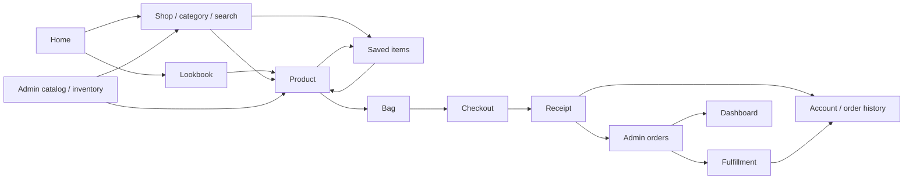

# AFTERFORM

Design and product handoff for a reusable e-commerce prototype. The demo sells contemporary apparel and accessories in English and USD. It covers the customer journey and the staff workflow in the same browser.

## Research and design decisions

| Reference | Observed pattern | AFTERFORM decision |
| --- | --- | --- |
| [SSENSE Editorial](https://www.ssense.com/en-us/editorial) and [PORTER](https://www.net-a-porter.com/en-us/porter) | Fashion stories and occasions create a second way into a product assortment. PORTER connects cover stories to a shopping edit. | Let shoppers browse by garment type or follow a campaign into its own collection. Give editorial material a direct path to the products it depicts. |
| [COS New Arrivals](https://www.cos.com/en-us/women/new-arrivals) and [Studio Nicholson](https://www.studionicholson.com/) | Product categories and curated looks can sit next to each other. Assigned product imagery supports an editorial grouping without hiding the basic shop navigation. | Use the citron category strip as a dependable catalog entry and the campaign cover as a separate, shoppable entry. |
| [UNIQLO LifeWear](https://www.uniqlo.com/us/en/special-feature/lifewear-collection) and [BAGGU Shop All](https://baggu.com/collections/all) | Outfit photographs show styling in context. A consistent accessory silhouette can carry several colorways across an assortment. | Keep a distinct photographic language for campaigns and repeatable framing for the product grid. Associate gallery looks with product IDs and colorways with their own images where available. |
| [Arc’teryx System 0 by forpeople](https://www.forpeople.com/projects/arcteryx-system0-circularity/) and [Rottefella by Infinum](https://infinum.com/work/rottefella/) | Movement communicates product construction. Switching between field photography and product views adds context to a narrative. | Reserve the largest motion for changing campaign and gallery images. Use small state changes when a shopper selects a size, saves a product or adds it to the bag. |
| [Everlane](https://www.everlane.com/) and [Baymard checkout research](https://baymard.com/research-articles/make-guest-checkout-prominent) | A useful empty bag offers a route back into the catalog. A visible guest checkout reduces ambiguity at the start of payment. | Offer a direct continue-shopping action from an empty bag. Let people place a demo order as guests, with sign-in as a separate choice. |
| [Baymard product filters](https://baymard.com/research/ecommerce-product-lists), [image thumbnails](https://baymard.com/research-articles/always-use-thumbnails-additional-images) and [in-scale photography](https://baymard.com/research-articles/in-scale-product-images) | Filtering and visible image choices help customers compare items and assess fit, texture and scale. | Make active filters and clear-all easy to find. Pair product images with labelled thumbnails where multiple views exist. Use apparel on models and bags on the body to communicate scale. |
| [Shopify admin navigation](https://help.shopify.com/en/manual/shopify-admin/shopify-admin-overview) and [Shopify Analytics](https://help.shopify.com/en/manual/reports-and-analytics/shopify-reports/overview-dashboard/) | Staff switch between order queues, catalog management and date-scoped reports. | Group related admin destinations, keep time periods explicit and make order IDs and low-stock rows actionable where supporting views exist. Apply AFTERFORM typography, spacing and color to the admin. |

## Visual system

AFTERFORM takes its cues from an independent fashion magazine and the garment racks behind a runway. The home cover pairs a two-line headline with inset amber-lit photography. On phones the compact caption and controls bring the photograph into view sooner. The shop follows the rhythm of a print catalog through consistent crops, fine rules, aligned captions and ample gutters. Citron identifies primary actions and selected admin navigation. Small corner radii soften controls and image frames.

| Token | Value or role | Usage |
| --- | --- | --- |
| Paper | `#f8f7f2` | Default surface and space around product images |
| Ink | `#22231b` | Text, dark surfaces and high-contrast controls |
| Citron | `#dfef48` | Primary calls to action and selected admin controls, paired with ink |
| Supporting surfaces | Warm off-white and amber-brown from photography | Editorial layouts and subtle separation of data groups |
| Type | Geist and Instrument Serif Italic | Geist serves navigation, headings and tabular figures. Instrument Serif Italic adds contrast to campaign and editorial titles. |
| Grid | Twelve-column desktop concept, simplified on smaller screens | Split cover, aligned merchandise tiles and side-by-side photo and purchase panels on desktop. Portrait-focused crops and stacked forms on mobile. |

Photography has three roles. A campaign frame establishes the collection. A clean product frame makes the shape and finish legible at a glance. An alternate frame shows the object in use or at detail scale. Keep crops intentional, product descriptions free of marketing filler and meaningful image alt text specific to the item or scene.

Font files and their open licenses are bundled in `assets/`. [Geist](https://github.com/google/fonts/tree/main/ofl/geist) · [Instrument Serif](https://github.com/google/fonts/tree/main/ofl/instrumentserif)

### Interaction and accessibility

- A campaign change uses a short image fade and gentle zoom. Category links draw a fine underline on interaction. Drawers and quick add controls enter with short travel. Quick add stays visible on touch and appears on hover or keyboard focus with a fine pointer. A reduced-motion preference switches to immediate state changes. [W3C technique C39](https://www.w3.org/WAI/WCAG22/Techniques/css/C39.html)
- Menus, galleries, swatches and drawers need keyboard paths and visible focus. An open modal limits focus to its own controls, closes on Escape and returns focus to the trigger. A lookbook hotspot or gallery-only action also appears as a text link or button in the same reading order.
- Mobile browsing keeps card names and prices visible. Menus and filter drawers fit the viewport and expose an explicit close action. Reflow checkout fields and dashboard data tables, with scroll available inside dense tables when necessary.
- Color names, status labels and chart values accompany visual signals. Provide actionable form errors at the relevant field and announce quantity and cart changes to assistive technology.

## End-to-end flow

| Stage | Screen or entry point | Expected behavior |
| --- | --- | --- |
| Discover | Home, collection and gallery/lookbook | Explore the current campaign or go straight to the catalog. Each collection groups products around an edit, and a look links any featured piece to its product detail. |
| Find | Shop, category and search | Browse by item type or enter a term. Filters narrow results by available attributes, sorting changes order, and an empty state offers a path back to results. |
| Evaluate | Product detail and image gallery | Inspect imagery, price, material and fit. Choose a valid size and color, see availability, and add the selected variant to the bag. Save the item to revisit it. |
| Retain | Saved items, sign-in, registration and account | Return to earlier selections. The account view makes orders and their current statuses discoverable. Returning shoppers can sign in before or during checkout. |
| Purchase | Bag, checkout and receipt | Update quantity or remove a line, review fees and total, enter required information and submit simulated payment. The receipt exposes a stable order reference. |
| Fulfill | Admin dashboard, orders and order detail | Find the order by ID, see its item and delivery snapshot and progress fulfillment. The same order reference and status appear to customers and staff. |
| Maintain | Admin catalog, inventory and reports | Inspect products and variant availability. Staff use catalog and stock changes to control what shoppers can buy, and date filters scope example reporting. |

### Screen contracts

- Store navigation exposes a catalog path, an editorial path, search, account and bag from the main storefront. Campaign controls label what will change and leave products accessible without animation.
- Shop views share the same card and filtering pattern across collections, categories and search. The product detail is the decision screen and keeps the media gallery, selected variants, availability and add-to-bag control in close proximity.
- Auth separates creation and sign-in while keeping links between the two views. A guest enters delivery details at checkout without creating an account. A demo account uses the same order record when the checkout belongs to that session.
- The bag summarizes the selected variant, unit price and quantity per row. Checkout computes totals from the cart and presents payment as a simulation. A successful submission clears that cart after an order record exists. Failed validation preserves input and prevents duplicate order creation.
- The admin starts with business totals and trends, then exposes the work behind the numbers through orders and merchandise. Customer and shipping details belong on the order screen. Visibility and inventory changes belong to catalog and stock controls.

### Order and reporting model

In the local prototype, the checkout-to-admin handoff uses shared browser state. A placed order carries an ID, customer and delivery information, a timestamp, a price/currency snapshot and line items tied to product and variant IDs. Historical receipts remain intelligible after catalog names or prices change. A quantity change acts on a variant, so the same product in different sizes can have separate bag lines. Customer history and admin order views use the same source record.

The order model keeps order, payment and fulfillment states separate. The demo payment step produces a simulated payment result. Staff can change fulfillment from Unfulfilled to Packed, Shipped or Delivered. Cancellation and refund status changes update the record. Production will need payment and inventory policies for the corresponding transactions. Charts carry a stated period and unit. The sales and order-volume calculations use the saved order records, including newly placed demo orders.

## Reuse across industries

| Extension point | Responsibility | Examples |
| --- | --- | --- |
| Theme | Name, logotype, colors, typography, imagery and labels | Replace AFTERFORM with a homeware, beauty or electronics identity. Keep navigation, forms and order interactions consistent. |
| Catalog | Product records, slugs, category tree, collections, images, descriptive attributes, variants and stock | Replace Size and Color with Finish and Dimensions, Shade and Volume, or Capacity and Connector. Use category-relevant filters and units. |
| Content | Homepage campaign, gallery entries, look-to-product links, copy and support policies | Turn a style look into a furnished room, a skincare routine or a gear setup. Reuse the same product association. |
| Market | Locale, currency, delivery options and formatting | The demo uses English and USD. Keep monetary arithmetic in minor units at the service boundary and format currency by market. |
| Commerce services | Customer identity, catalog, checkout, orders, stock and analytics | Keep data access behind a dedicated boundary so browser persistence can be replaced by real APIs without redesigning the screens. |

The prototype identifies bag lines by product ID, size and color, and tracks inventory by size. A second industry can start by replacing seed data, theme and campaign content. Industries that need different variant dimensions or inventory per combination should introduce stable variant IDs and typed attributes with configurable labels and units. Keep collections separate from categories so a product can appear in several campaigns. Verify the complete buy-and-fulfill path with the new variant model.

## Prototype and production boundaries

This is a frontend prototype with local demonstration data. The browser profile defines the persistence boundary. Sign-in demonstrates the user interface and account journeys. Checkout demonstrates order placement without collecting real payment credentials. Use sample customer and shipping information during demos. Workspace data and mock performance metrics represent fictional activity.

A production build needs server-side identity and authorization, a durable shared database, hosted payment handling, authoritative pricing and inventory validation, fulfillment and email providers, and telemetry for real reports. Order submission needs an idempotent server operation and an inventory policy for simultaneous purchases. Staff access needs role permissions and an audit trail. These services can replace the browser-backed data layer while preserving the screen contracts and visual system.
